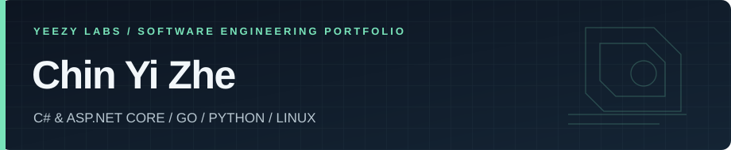

  

  <strong>Software engineering student in Malaysia</strong> 
  C# / ASP.NET Core · Go · Python · Linux · Security engineering

  <a href="https://github.com/chinyizheishuman/eduvo-mvc-modernization">Explore Geek Lab</a>
  &nbsp;·&nbsp;
  <a href="https://github.com/chinyizheishuman?tab=repositories">Repositories</a>
  &nbsp;·&nbsp;
  <a href="https://labs.cyberwarfare.live/credential/achievement/6ac84dbadfb0f59fc7639062">Security training</a>

## About

I'm Yeezy. I work with C#, Go and Python, and spend a lot of time on Linux, networking and figuring out how software behaves outside the happy path.

My coursework introduced me to full-stack and mobile development. Most of my independent learning has been in programming, systems and cybersecurity. I like tracing a failure to the code that caused it, changing what needs to change, and checking the result.

I'm currently looking for a **software engineering internship in Malaysia** to complete the practical training requirement of my Professional Diploma at **Eduvo Academy**.

## Selected work

<table>
<tr>
<td width="50%" valign="top">

### [Geek Lab](https://github.com/chinyizheishuman/eduvo-mvc-modernization)
**ASP.NET Core MVC · C# · SQL Server**

A three-role e-commerce application I built for DSE207 in 2025, then returned to in 2026 to repair missing views, broken checkout paths and inventory handling.

The repository includes real screenshots, test cases and a documented last-unit SQL Server concurrency check.

[Code](https://github.com/chinyizheishuman/eduvo-mvc-modernization) · [Verification](https://github.com/chinyizheishuman/eduvo-mvc-modernization/blob/main/docs/VERIFICATION.md)

</td>
<td width="50%" valign="top">

### TRACEPROOF
**Security regression engineering · In development**

A separate project exploring how AI can propose defensive regression checks while tests, outputs and source changes provide the evidence.

Still private and under development. No release or completed engine is claimed.

**Focus:** Code changes, isolated tests, reproducible results.

</td>
</tr>
<tr>
<td width="50%" valign="top">

### Mobile shopping application
**Ionic · Angular · TypeScript**

Coursework covering product browsing, favorites, cart, profiles and order history.

</td>
<td width="50%" valign="top">

### Student records management
**C# · File processing**

Console coursework covering record imports, searching, grades and reporting.

</td>
</tr>
</table>

## Technical areas

| Area | Technologies and experience |
| --- | --- |
| Software | C#, Go, Python, JavaScript, TypeScript |
| Web and mobile | ASP.NET Core MVC, Razor, Angular, Ionic |
| Data | SQL Server, EF Core, relational database concepts |
| Systems | Linux, Windows, networking, Git |
| Testing and security | xUnit, HTTP integration tests, debugging, defensive code review |

## Credentials

- **[TryHackMe Certified Junior Penetration Tester (PT1)](https://assets.tryhackme.com/certification-certificate/69fd3c959aa0c9e61c800a98.pdf)**. Issuer-hosted certificate.
- **[Certified Blue Team Fundamentals (BTF)](https://labs.cyberwarfare.live/credential/achievement/6ac84dbadfb0f59fc7639062)**. Cyberwarfare Labs.
- **[Certified Cyber Security Analyst (C3SA)](https://labs.cyberwarfare.live/credential/achievement/6ac81ed6dfb0f59fc76366c9)**. Cyberwarfare Labs.

These link to the original verification pages. They reflect training, not a claim that every application or tool I touch is secure.

## Education

**Eduvo Academy**  
Professional Diploma in Software Engineering. Coursework completed, internship requirement pending.

I'm looking for a team where I can contribute to real code, learn through review and keep improving how I test and maintain software.
